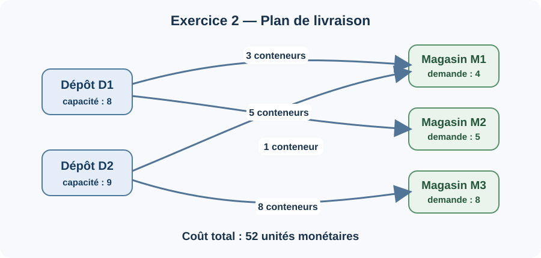
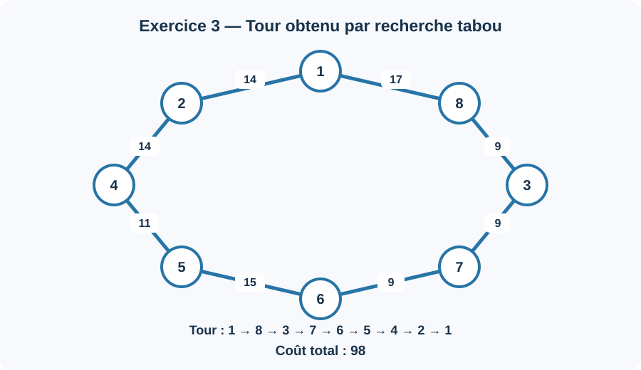

# TD n° 2 — Recherche opérationnelle

Programmes Python séparés pour les exercices 2 et 3 : problème de transport et voyageur de commerce.

## Exercice 2 — Problème de transport

La recherche tabou propose les livraisons suivantes. Les demandes et les capacités sont toutes respectées.

| Dépôt / Magasin | M1 | M2 | M3 | Capacité utilisée |
|---|---:|---:|---:|---:|
| D1 | 3 | 5 | 0 | 8 / 8 |
| D2 | 1 | 0 | 8 | 9 / 9 |
| **Demande reçue** | **4 / 4** | **5 / 5** | **8 / 8** | |



**Coût total : 52** unités monétaires.

## Exercice 3 — Voyageur de commerce

Les tirets de la matrice sont considérés comme des liaisons interdites. La recherche tabou utilise un voisinage 2-opt et trouve le tour suivant :

`1 → 8 → 3 → 7 → 6 → 5 → 4 → 2 → 1`



Le coût de ce tour est **98**. Le recuit simulé est exécuté pendant les **5 itérations** demandées; avec la graine fixée dans le programme, le meilleur tour conservé a un coût de **103**.

## Lancer le programme

Python 3.10 ou version ultérieure suffit. Aucune bibliothèque externe n'est nécessaire.

```bash
python exercice2.py
python exercice3.py
```

## Fichiers

- `exercice2.py` — programme de l'exercice 2 (recherche tabou pour le transport).
- `exercice3.py` — programme de l'exercice 3 (recherche tabou et recuit simulé pour le TSP).
- `rapport_td2.md` — formulation, explications et résultats détaillés.
- `images/` — schémas des solutions des deux exercices.

L'algorithme génétique listé dans l'énoncé de l'exercice 3 n'est pas inclus, conformément à la demande de se limiter au recuit simulé et à la recherche tabou.
